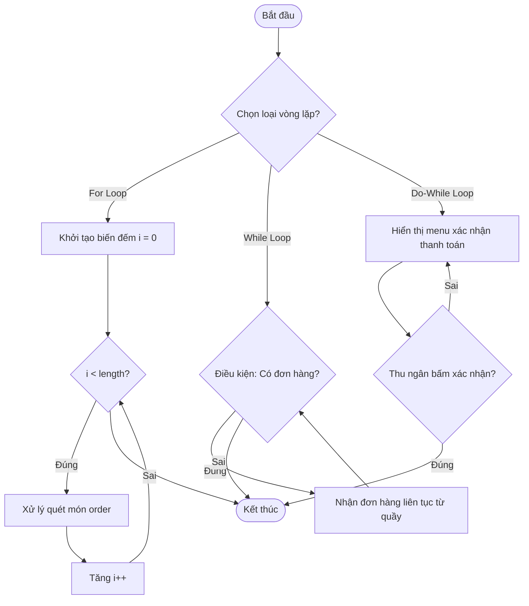

# BÁO CÁO PHÂN TÍCH TRADE-OFF: VÒNG LẶP FOR VS WHILE TRONG DUYỆT DỮ LIỆU HIGHLANDS POS

> 👤 **Học viên:** Hoàng Công Dũng | **Mã SV:** PTIT-HCM-009
> 🏫 **Môn học:** it103b-rl-HoangCongDung

---

## 📊 Sơ đồ thiết kế hệ thống (Flowchart)

> 💡 *Sơ đồ dưới đây được render tự động trực tiếp trên GitHub bằng Mermaid. Bạn cũng có thể tải file **`bt4.drawio`** trong repository này để mở và chỉnh sửa trực tiếp trên [Draw.io (diagrams.net)](https://app.diagrams.net).* 

---

## 1. Mục tiêu và Ngữ cảnh bài toán

Bài tập này phân tích sâu sắc ưu nhược điểm của ba cấu trúc lặp gồm for, while và do-while trong hệ thống Highlands POS. Mục tiêu cốt lõi là chọn đúng cấu trúc lặp cho từng bài toán cụ thể nhằm tối ưu hiệu năng duyệt dữ liệu và đảm bảo tính đúng đắn của nghiệp vụ.

Đội ngũ phát triển đang phân chia 3 tính năng chính cần xử lý lặp lại gồm: Quét danh sách các món trong hóa đơn có độ dài cố định, nhận đơn hàng liên tục từ quầy đến khi chốt ca, và bắt buộc hỏi xác nhận thanh toán ít nhất một lần.

- Xác định rõ ràng thời điểm kiểm tra điều kiện của từng loại vòng lặp.
- Tránh các lỗi logic phổ biến như lặp vô hạn hoặc bỏ sót dữ liệu do chọn sai cấu trúc.
- Tối ưu hóa mã nguồn JavaScript theo chuẩn ES6+.

## 2. Bảng đối chiếu kỹ thuật Trade-off

Dưới đây là bảng phân tích chi tiết các tiêu chí kỹ thuật giữa vòng lặp for, while và do-while dựa trên các yêu cầu thực tế của hệ thống POS:

| Tiêu chí | Vòng lặp for | Vòng lặp while | Vòng lặp do-while |
| --- | --- | --- | --- |
| Số lần lặp | Biết trước (đếm bước, độ dài mảng) | Chưa biết trước (phụ thuộc điều kiện động) | Chưa biết trước (phụ thuộc điều kiện động) |
| Thời điểm kiểm tra | Đầu vòng lặp | Đầu vòng lặp | Cuối vòng lặp |
| Số lần lặp tối thiểu | 0 lần | 0 lần | Ít nhất 1 lần |
| Ứng dụng POS tối ưu | Quét chuỗi món order order.length | Đợi khách quẹt thẻ / Rút tiền thừa | Menu nhắc lệnh xác nhận thanh toán |

## 3. Phân tích chi tiết ngữ cảnh và giải pháp mã nguồn

Dựa vào đặc tả nghiệp vụ, việc áp dụng đúng cấu trúc lặp giúp code vừa tường minh vừa chạy mượt mà. Vòng lặp for phù hợp tuyệt đối cho mảng tĩnh có độ dài xác định như 'order.length'. Vòng lặp while là lựa chọn hàng đầu cho các tác vụ lắng nghe sự kiện bất định từ phần cứng quẹt thẻ. Vòng lặp do-while đảm bảo khối lệnh thực thi tối thiểu một lần trước khi hỏi lại ý kiến người dùng.

- Sử dụng 'for' khi đã xác định rõ số vòng lặp từ trước.
- Sử dụng 'while' khi điều kiện dừng phụ thuộc hoàn toàn vào trạng thái ngoài luồng.
- Sử dụng 'do-while' khi bắt buộc phải thực hiện hành động ít nhất một lần như hiển thị modal xác nhận.

---

## 📁 Danh sách tệp tin nộp bài trong Repository
- 📝 `bt4.docx`: Báo cáo tài liệu phân tích nghiệp vụ hoàn chỉnh.
- 🎨 `bt4.drawio`: File thiết kế sơ đồ chuẩn theo quy định đề bài (mở trực tiếp bằng [Draw.io](https://app.diagrams.net) hoặc Lucidchart).
- 💻 `solution_ex10.js`: Mã nguồn chương trình.
